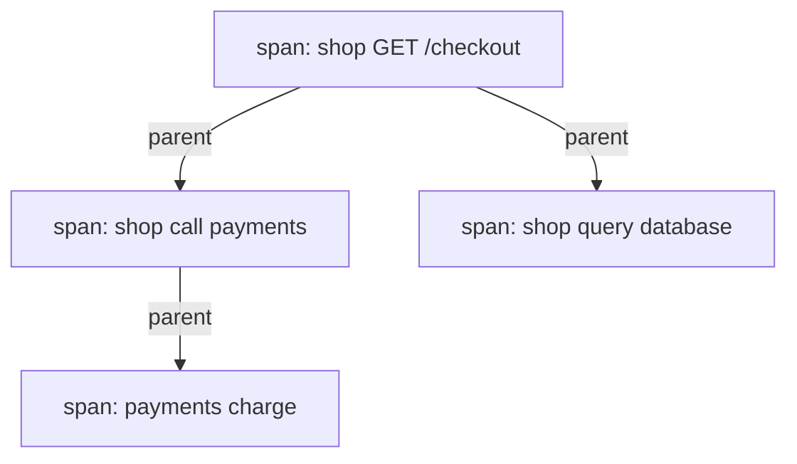

# Distributed Traces And Trace Context

A metric says that checkout requests are slow. A log record says that one request failed. Neither tells you which of the several services behind the request spent the time or raised the error. A distributed trace answers that question. This part explains what a trace holds, how its identifiers travel between services, and what a trace can and cannot prove.

## What A Trace Is

A trace is the record of one request as it passes through all the services that work on it. It is made of spans. A span is one timed operation: it has a name, a start time, a duration, a status and a set of attributes. For example, one span can describe the handling of the HTTP request by the `shop` service, and another can describe the call from `shop` to a `payments` service.

Every span carries three identifiers. The trace identifier is the same for all spans of one request. The span identifier names one span. The parent span identifier points to the span that caused this one. The parent links turn a flat list of spans into a tree, and the tree shows the order and the nesting of the work.



The diagram shows one trace with four spans. The first span is the root, and the other three are its descendants. The duration of each span shows where the time of the request went.

## What A Trace Answers

A trace answers questions about one request that a metric cannot answer. Which service was slow? Which call failed first? Did two calls run one after the other, or at the same time? A metric aggregates many requests and loses this detail. A log record keeps detail but only from one service, and without a shared identifier it cannot be joined to the records of the other services.

The trace does not replace the other signals. Use the metric to find that a problem exists and how large it is. Use the trace to find which service and which call hold the problem. Use the log record of that service to read the error text and the context. The trace identifier is the link: when a service writes the trace identifier into each log record, you can move from a span to the matching log records, and the reverse.

## How The Identifiers Travel

The tree can only be built if every service gets the trace identifier and the parent span identifier from the caller. This is called context propagation. For HTTP, the caller adds a request header, and the called service reads it. The W3C Trace Context standard defines the header `traceparent`. Its value has four fields separated by dashes: a version, the trace identifier of 32 hexadecimal characters, the parent span identifier of 16 hexadecimal characters, and flags.

```text
traceparent: 00-0af7651916cd43dd8448eb211c80319c-b7ad6b7169203331-01
```

In this example the version is `00`, the trace identifier is `0af7651916cd43dd8448eb211c80319c`, the parent span identifier is `b7ad6b7169203331`, and the flags are `01`. The lowest bit of the flags is the sampled flag. A value of `01` tells every service that the caller decided to record this trace.

The called service starts a new span. It uses the received trace identifier, it creates its own span identifier, and it records the received parent span identifier as the parent of the new span. When the called service calls another service, it sends a `traceparent` header with the same trace identifier and its own span identifier. This is how one trace stays whole across many services.

## Who Creates The Spans

The application code, a library or an agent creates spans. This is called instrumentation. Many web frameworks and HTTP clients have instrumentation libraries that start a span for each incoming and outgoing request and read and write the header for you. OpenTelemetry is the common open standard for this work. It defines the data model, the programming interfaces and the wire protocol, called OTLP (OpenTelemetry Protocol).

The application sends finished spans to a collector, for example the OpenTelemetry Collector. The collector is a separate process. It receives spans, can process them, for example by adding attributes or dropping some, and exports them to a storage backend that can search and display traces. Each of these steps is separate from the application, in the same way as log collection is separate from standard output.

## Resource Identity On Spans

A span says what happened, and the resource says where. A resource is a set of attributes that describe the entity that produced the telemetry, such as the service name, the namespace, the pod name and the version. In Kubernetes, the pod and the namespace attributes let you connect a span to the same pod that a metric label or a log record names. Without a stable service name, the trace tree has spans that nobody can assign to a service.

The same resource attributes should appear on metrics, logs and spans. When they do, a search for the pod named in a slow span finds the log records and the metric series of that pod. When one signal uses `app` and another uses `service_name` for the same thing, the join breaks, and you must map the names by hand.

## Sampling Of Traces

Storing every span of every request costs a lot of storage and network capacity. Traces are therefore usually sampled. Head sampling decides at the start of the trace, in the first service, whether to record it. The decision is sent in the sampled flag, so every service follows it. Head sampling is cheap, but it decides before it knows whether the request will fail or be slow.

Tail sampling decides after the trace is complete. A collector holds the spans of a trace until it has seen all of them, then keeps traces that are slow or have an error and drops most of the others. Tail sampling keeps the interesting traces, but it needs memory in the collector and all spans of one trace must reach the same collector instance.

Sampling has one consequence that you must remember. The absence of a trace for a request does not show that the request did not happen. It may only mean that the request was not sampled. A count of traces is also not a count of requests, and a ratio from sampled traces has the same weighting problem as a ratio from sampled logs.

## Where Traces Break

A trace has gaps when propagation fails. A service that does not read the `traceparent` header starts a new trace, and the trace is split into two traces that nobody can join. A proxy or gateway that strips unknown headers does the same. Messages sent through a queue need the context in the message metadata, because there is no HTTP header; if the producer or the consumer does not copy it, the consumer's spans have no parent.

Clocks add another problem. Each span records the time from the clock of its host. If two hosts disagree by tens of milliseconds, a child span can appear to start before its parent. The parent links still show the true order of the calls, so use them and not the timestamps alone to read the causal order.

Finally, a trace shows time and structure, and it does not show everything. A span with a long duration does not say why the operation was slow. The cause can be a lock, a full connection pool or a slow disk, and you need attributes, logs or metrics to find it.

## Reading A Trace Step By Step

Take a trace of a slow checkout request with four spans, as in the diagram above. Suppose the root span of `shop` lasts 1200 milliseconds, the call to `payments` lasts 1050 milliseconds, and inside it the `payments` service span for the charge lasts 1000 milliseconds. The database query of `shop` lasts 30 milliseconds. These numbers are an example to show the method, not output of a real system.

Read from the root downward. The root span shows the total time of the request. Subtract the time of the children that ran one after the other. Most of the time is inside the call to `payments`, and almost all of that is inside the charge span of the `payments` service. The slow part is therefore the charge operation, not the network between the two services, because the difference between the client span and the server span is small.

The gap between a client span and the server span it called is the time in the network, in queues and in the connection setup. A large gap points to the path between the services. A large server span points to the work inside the called service. This single comparison separates two very different problems, and no metric of one service can show it.

## Traces Compared To Metrics And Logs

The three signals differ in what they keep per request and in what they cost. Use the table to choose the first signal to open for a given question.

| Signal | Keeps | Best first question | Main limit |
| --- | --- | --- | --- |
| Metric | A number per time interval and label set | Is something wrong, and how large is it | No single request |
| Log record | One event with its context in one service | What did this service report | No view across services without an identifier |
| Trace | The timed tree of one request across services | Which service and call held the time or the error | Sampling and broken propagation leave gaps |

An investigation often moves through all three. A metric alert says that the failure rate of `/checkout` rose. A search of traces for failed checkout requests shows that the error starts in `payments`. The log records of `payments`, found by the trace identifier, show the error text. Each signal narrows the next search.

## Common pitfalls

> [!WARNING]
> A missing trace does not prove that a request did not happen, because sampling can drop it. Spans from a service that does not forward `traceparent` form a separate trace. A long span shows where time went, not why. Never put personal data or secrets in span attributes, because traces are stored and read like logs.
