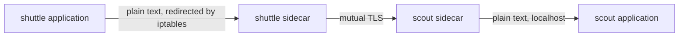

# Mesh Identity And Certificates

Encrypting a connection is easy. Knowing who is on the other end is the hard part. A service mesh solves it by giving every workload a certificate that names the workload, and by having the proxies check those certificates on every connection. This part follows a certificate from the moment a pod starts to the moment it is replaced.

## How the sidecar gets into the pod

Istio in sidecar mode adds a second container, `istio-proxy`, to every pod in a namespace that has the label `istio-injection: enabled`. The addition happens when the pod is created. The Kubernetes API server calls a mutating admission webhook that belongs to `istiod`, and the webhook rewrites the pod specification before the pod is stored. The application manifest does not contain the sidecar. The stored pod does.

The proxy is Envoy, started by a small program called `pilot-agent`. Two more things are added to the pod. An init container, `istio-init`, writes iptables rules in the pod network namespace. These rules redirect all inbound TCP traffic to the proxy on port 15006 and all outbound traffic to the proxy on port 15001. The application keeps calling `http://probe.starfleet/`, and the kernel hands the connection to the proxy without the application knowing.



The hop between a sidecar and its own application is plain text on the loopback interface, inside one pod. The hop between two sidecars is the one the mesh protects.

Check that every pod in `starfleet` has the sidecar:

<!-- astrona:playground:renew -->

```sh
kubectl -n starfleet get pods -o custom-columns='NAME:.metadata.name,CONTAINERS:.spec.containers[*].name,INIT:.spec.initContainers[*].name'
```

Each pod lists its application container and `istio-proxy`. The init column shows `istio-init`. The pod `drifter` in `outpost` is not in this namespace, so it has no sidecar.

## The certificate authority

`istiod` is the control plane. One of its jobs is to act as a certificate authority (CA). A CA is a service that signs certificates, so that anyone who trusts the CA can trust the signed certificate. Every workload certificate in the mesh is signed by the same root, and every sidecar receives the root certificate so it can verify the others.

A sidecar asks for its certificate when it starts. The mechanism has four steps:

1. `pilot-agent` generates a private key inside the pod. The key never leaves the pod.
2. It builds a certificate signing request (CSR) for that key.
3. It sends the CSR to `istiod` together with the Kubernetes service account token of the pod.
4. `istiod` asks the API server to validate the token. The token states which namespace and service account the pod runs as. `istiod` then signs a certificate for exactly that identity and returns it.

Envoy receives the key and certificate through the Secret Discovery Service (SDS), a local API between `pilot-agent` and Envoy. No Kubernetes Secret object holds the private key. The certificate lives in the memory of the proxy.

## What the identity looks like

The signed certificate carries one identity in the Subject Alternative Name (SAN) field, as a URI in the SPIFFE format:

```text
spiffe://<trust domain>/ns/<namespace>/sa/<service account>
```

SPIFFE is a standard for workload identity. The trust domain is a name for the whole mesh, `cluster.local` by default. The remaining parts come from the service account token. So `scout`, which runs as the service account `scout` in `starfleet`, receives `spiffe://cluster.local/ns/starfleet/sa/scout`.

The identity is the service account, not the pod name, the pod IP or the Deployment. Two Deployments that use the same service account share one identity. Pods that are replaced keep the same identity. This is why `caller` in the playground, which runs as the service account `probe`, has the same identity as the `probe` workload. Later policy can only tell workloads apart by the service account that they use.

Read the identity from the proxy. Envoy has an admin interface on port 15000, reachable only from inside the pod, and `curl` is present in the `istio-proxy` container:

```sh
mesh_identity() {
  kubectl -n starfleet exec "deploy/$1" -c istio-proxy -- curl -s localhost:15000/certs \
    | jq -r '[.certificates[].cert_chain[]?.subject_alt_names[]?.uri] | unique | .[]'
}
mesh_identity scout
mesh_identity probe
mesh_identity caller
```

`scout` ends in `/ns/starfleet/sa/scout`. `probe` and `caller` print the same identity, ending in `/sa/probe`, because they share a service account. Compare with the Deployment:

```sh
kubectl -n starfleet get deploy caller -o jsonpath='{.spec.template.spec.serviceAccountName}{"\n"}'
```

The value is `probe`. The certificate follows the service account, and nothing else.

## Validity and rotation

The same output of `/certs` contains the validity period of each certificate. Print the fields that describe it:

```sh
kubectl -n starfleet exec deploy/scout -c istio-proxy -- curl -s localhost:15000/certs \
  | jq '.certificates[].cert_chain[] | {valid_from, expiration_time, days_until_expiration}'
```

By default a workload certificate is valid for 24 hours. A short lifetime limits the damage of a stolen key, because the key stops working at the expiry time. `pilot-agent` does not wait for the end. By default it requests a new certificate when about half of the lifetime has passed, and Envoy switches to the new certificate without dropping connections. The identity in the new certificate is the same. The key, the serial number and the validity period change.

A stolen certificate is a stolen identity until it expires. A short lifetime shortens that window, and it does not close it. There is no revocation list for workload certificates in the default setup. Removing a compromised workload means deleting the pod, and denying its service account in policy.

## Why the identity survives a restart

Delete the `scout` pod and read the identity of the replacement:

```sh
kubectl -n starfleet delete pod -l app=scout
kubectl -n starfleet rollout status deploy/scout --timeout=120s
mesh_identity scout
```

The identity is unchanged. The new pod has a new name, a new IP, a new private key and a new certificate with a new serial number. It sends a new CSR with a new service account token that names the same service account, and `istiod` signs the same identity.

This is the property that policy relies on. A rule that says "allow `sa/shuttle`" keeps working across rollouts, scaling and node moves. It also means that the identity is only as strong as the control over the service account. Anyone who can create a pod that uses the service account `shuttle` in `starfleet` receives the identity of `shuttle`.

## What the certificate does not tell you

A workload certificate says which service account the pod used when it started. It does not say which version of the code is running, which person triggered the request, or whether the application has been compromised since. Code that runs inside a pod with the service account `shuttle` can use the identity of `shuttle`. Mutual TLS proves the peer. Judging the peer is a policy decision.

## Common pitfalls

> [!WARNING]
> The identity is the service account. Workloads that share a service account share an identity, and a rule written for one of them also covers the others. Create one service account per workload that policy must tell apart, and do not use the `default` service account for workloads that need their own rules.
