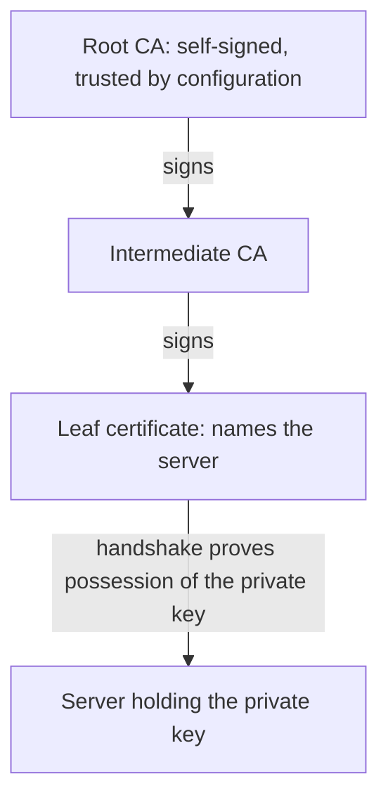

# Keys, Certificates And Chain Verification

A client that connects to a server must answer one question before it sends anything private: is this really the server I meant to reach? Public key infrastructure (PKI) answers it with signed certificates. This part explains the pieces, and then checks a real certificate step by step.

## Key pairs and signatures

A key pair has two parts that belong together. The **private key** is a secret that only the owner may hold. The **public key** can be given to anyone. The pair has one useful property: something signed with the private key can be checked with the public key, and nobody can produce a valid signature without the private key.

A signature is not encryption of the data. It is a value computed from the data and the private key. Anyone who has the data, the signature and the public key can check that the data was not changed after signing and that the signer held the private key. A change of a single byte in the data makes the check fail.

A public key alone does not say whose it is. A message that says "this key belongs to `scout`" is worthless if anyone can write it. A certificate adds a signature from a party that the verifier already trusts.

## What a certificate contains

A certificate (X.509 format) is a signed statement that ties an identity to a public key. The main fields are:

| Field | Meaning |
| --- | --- |
| Subject | The identity that the certificate names, such as `CN=kube-apiserver` |
| Subject Alternative Name (SAN) | The names and addresses for which the certificate is valid, such as DNS names and IP addresses |
| Public key | The key that belongs to the subject |
| Issuer | The authority that signed the certificate |
| Validity | The `notBefore` and `notAfter` times |
| Key usage and extended key usage | The purposes allowed, such as server authentication or client authentication |
| Basic constraints | Whether the certificate belongs to a certificate authority (CA) that may sign other certificates |
| Signature | The issuer's signature over all fields above |

A **certificate authority (CA)** is a key pair whose certificate is trusted by the verifier. It signs the certificates of other parties. A **root CA** signs its own certificate, which is called self-signed. The verifier does not check a root through a signature. It accepts the root because it was configured to trust it, in a file or a trust store.

## Verification steps

When a client receives a server certificate, it runs these checks. All of them must pass:

1. The signature on the certificate is valid for the public key of the issuer.
2. The issuer chains to a certificate that the client trusts. A chain can have intermediate CAs between the leaf and the root, and each link must be signed by the one above it and must be marked as a CA.
3. The current time is inside the validity period of every certificate in the chain.
4. The name that the client meant to reach is in the SAN list. The check is on the name the client typed or configured, not on a name the server supplies.
5. The key usage allows the purpose. A certificate that is only valid for client authentication is not accepted for a server.
6. For a connection that proves the possession of the key, the server completes a handshake that only the holder of the private key can finish.



Failure at any step must stop the connection. Disabling verification, for example with `curl -k` or `insecure-skip-tls-verify`, removes steps 1 to 5 together and accepts any server that answers.

## Look at a real certificate

The API server of the playground has a serving certificate. Read it on the control plane node:

<!-- astrona:playground:renew -->

```sh
export CONTROL_PLANE=astro-ats-078-playground-020-02-control-plane
node() { podman exec -i "$CONTROL_PLANE" "$@"; }
node ls /etc/kubernetes/pki
node openssl x509 -in /etc/kubernetes/pki/apiserver.crt -noout -subject -issuer -dates
```

The subject names the API server, the issuer is the cluster CA called `kubernetes`, and the dates show the validity period. Print the names and purposes:

```sh
node openssl x509 -in /etc/kubernetes/pki/apiserver.crt -noout -ext subjectAltName,extendedKeyUsage,basicConstraints
```

The SAN list holds DNS names such as `kubernetes.default.svc` and IP addresses of the node and the Service. A client that connects to the API server through one of these names passes the name check. A name that is not in the list fails it, even when the chain is valid. `extendedKeyUsage` holds `TLS Web Server Authentication`, and `basicConstraints` says `CA:FALSE`, so this certificate cannot sign other certificates.

Now read the CA certificate and compare:

```sh
node openssl x509 -in /etc/kubernetes/pki/ca.crt -noout -subject -issuer -dates -ext basicConstraints
```

For `ca.crt`, the subject and the issuer are the same, because the CA signed itself, and `basicConstraints` says `CA:TRUE`.

## Verify the chain yourself

`openssl verify` runs the signature, chain, time and purpose checks against a trusted CA file:

```sh
node openssl verify -CAfile /etc/kubernetes/pki/ca.crt /etc/kubernetes/pki/apiserver.crt
```

The result ends in `OK`. Now try the wrong authority. The cluster has a separate CA for its datastore, etcd:

```sh
node openssl verify -CAfile /etc/kubernetes/pki/etcd/ca.crt /etc/kubernetes/pki/apiserver.crt
```

The verification fails, because the API server certificate was not signed by the etcd CA. The message names the issuer that could not be found. The two CAs are independent on purpose. Trust in one does not extend to the other.

Check the time condition without waiting for expiry. `-checkend` asks whether the certificate is still valid after a number of seconds:

```sh
node openssl x509 -in /etc/kubernetes/pki/apiserver.crt -noout -checkend 0 && echo "valid now"
node openssl x509 -in /etc/kubernetes/pki/apiserver.crt -noout -checkend 31536000 && echo "valid for one more year" || echo "expires within one year"
```

The first command succeeds. The second shows how close the certificate is to its end.

## Name and purpose are part of trust

A valid signature does not say that a certificate may be used for any purpose or any name. A certificate for `scout.starfleet.svc` is not accepted for `probe.starfleet.svc`, and a certificate with the client authentication usage is not accepted as a server certificate. Verifiers check both.

The trust decision also depends on which roots the client accepts. A client that trusts a broad public trust store accepts every CA in it. A client that trusts only the cluster CA accepts only what the cluster CA signed. Narrow trust limits the damage when a different authority is compromised, which is why Kubernetes components trust a single cluster CA by file and not the system store.

## Common pitfalls

> [!WARNING]
> A certificate error means that one of the checks failed: signature, chain, time, name or purpose. Disabling verification accepts any server, so find the failed check instead. A name that is not in the SAN list fails even with a perfect chain. The private key is the identity, so a copied key is a copy of the identity.
