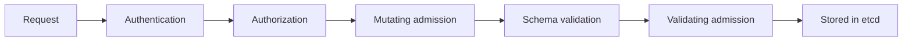

# The Admission Chain And Built-In Controllers

Every request to the API server passes the same stages in the same order. Admission is the stage that can change the object and the stage that can reject it for reasons that have nothing to do with the identity of the caller. This part shows the order, what each stage decides, and which controllers are built in.

## Where admission sits



Each stage answers one question:

- **Authentication** asks who is calling. A request that fails here gets `401`.
- **Authorization** asks whether this identity may perform this verb on this resource. RBAC is the usual answer. A request that fails here gets `403`.
- **Mutating admission** may change the object. Defaults, injected containers and added labels come from here.
- **Schema validation** checks that the object matches the API type, after the mutations.
- **Validating admission** may accept or reject the final object, and it cannot change it. A rejection returns `403` or another error with the reason.
- The object is written to etcd only when every stage agrees.

A request that fails any stage stops there. The order has two consequences. Validation sees the object after mutation, so a validating rule checks what would be stored and not what the user typed. And an identity that is allowed to create Pods can still have a request rejected, because authorization does not read the Pod spec.

Admission runs for requests that create, update or delete an object, and for requests that connect to a pod such as `exec`, `attach` and `port-forward`. It does not run for `get`, `list` and `watch`. A rule can therefore control what is stored and what is run, and it cannot hide an object from a reader.

## Mutation and validation

A mutating mechanism changes the request. The change can be harmless, such as a default value, or security relevant, such as an added sidecar container or a changed image. A validating mechanism only answers yes or no, with a message.

The two kinds work on different guarantees. A mutation does not prove that the result is safe, because the mutated object is checked only if a validating rule exists for the field. A rule that validates a field before a later mutation changes it checks the wrong object, which is why validating admission runs after all mutation.

An object that is stored can differ from the object the user wrote. The effective configuration is the stored one, so inspect it, not the file.

## Built-in plug-ins

The API server includes a list of admission plug-ins that are compiled in. Some are on by default, and kubeadm clusters add `NodeRestriction`. Several are about security:

| Plug-in | Kind | What it does |
| --- | --- | --- |
| `NamespaceLifecycle` | validating | Rejects new objects in a namespace that is being deleted |
| `LimitRanger` | mutating and validating | Applies default requests and limits from a `LimitRange`, and rejects a container outside the allowed range |
| `ResourceQuota` | validating | Rejects a request that would exceed the quota of the namespace |
| `ServiceAccount` | mutating | Sets the service account and mounts its token for a pod |
| `PodSecurity` | validating | Checks a pod against a Pod Security level set by namespace labels |
| `NodeRestriction` | validating | Limits what a kubelet may change to its own node and its own pods |
| `ValidatingAdmissionPolicy` | validating | Runs rules written in CEL that are stored as API objects |
| `MutatingAdmissionWebhook` and `ValidatingAdmissionWebhook` | mutating and validating | Call an external service for the decision |

Read the plug-ins that kubeadm turned on for the control plane in the playground:

<!-- astrona:playground:renew -->

```sh
export CONTROL_PLANE=astro-ats-078-playground-030-01-control-plane
podman exec "$CONTROL_PLANE" grep -n 'admission' /etc/kubernetes/manifests/kube-apiserver.yaml
```

Use `docker exec` if your container engine is Docker. In a kubeadm cluster the line is `--enable-admission-plugins=NodeRestriction`. This flag adds a plug-in to the default list and does not replace it. A plug-in that is on by default, such as `PodSecurity`, runs even though it is not on this line. To remove a default plug-in an operator must use `--disable-admission-plugins`, which is a change of the API server manifest.

## Watch a mutation

`LimitRanger` is a built-in mutation that is easy to see. Create a `LimitRange` that sets a default memory limit in `outpost`, then ask the API server to admit a pod that has no resources. A server-side dry run returns the object as the API server would store it, and it stores nothing:

```sh
kubectl apply -n outpost -f - <<'YAML'
apiVersion: v1
kind: LimitRange
metadata:
  name: default-memory
spec:
  limits:
    - type: Container
      default:
        memory: 96Mi
      defaultRequest:
        memory: 48Mi
YAML
kubectl apply -n outpost --dry-run=server -o jsonpath='{.spec.containers[0].resources}{"\n"}' -f - <<'YAML'
apiVersion: v1
kind: Pod
metadata:
  name: mutation-test
spec:
  containers:
    - name: app
      image: curlimages/curl:8.22.0
      command: ["sleep", "30"]
YAML
```

The file that you sent has no `resources` section. The output shows a memory limit of `96Mi` and a request of `48Mi`. The API server added both. Neither the user nor the manifest wrote them. Remove the `LimitRange` when you are done:

```sh
kubectl -n outpost delete limitrange default-memory
```

## Authorization and admission are separate checks

Take a service account that can create Pods in `starfleet` and nothing else. RBAC lets it create a privileged Pod, because RBAC checks the verb and the resource, not the contents. Admission rejects the Pod only if a rule exists for it. The two checks answer different questions, and each one needs the other:

- A narrowly authorized deployer can still submit an unsafe object. Admission is the control that reads it.
- An object that looks safe can still be submitted by a caller who has no right to create it. Authorization is the control that stops it.

## Ask without storing

A server-side dry run sends the request through every stage except the write to etcd. It reaches the built-in plug-ins, the policies and the webhooks, so it is the right way to test a rule. A client-side dry run (`--dry-run=client`) does not reach the API server and says nothing about admission. A webhook that has side effects declares it, so that a dry run does not trigger them.

```sh
kubectl apply -n starfleet --dry-run=server -f - <<'YAML'
apiVersion: v1
kind: Pod
metadata:
  name: admission-test
spec:
  containers:
    - name: app
      image: ghcr.io/stefanprodan/podinfo:6.15.0
YAML
```

With no policy in place, the output is `pod/admission-test created (server dry run)`. The rest of this module uses this request to test rules.

## Common pitfalls

> [!WARNING]
> Authorization does not read the object, so an allowed caller can submit an unsafe one. A client-side dry run never reaches admission. Mutation can change security-relevant fields, so read the stored object and not the manifest. Admission does not run for reads and does not change objects that are already stored.
