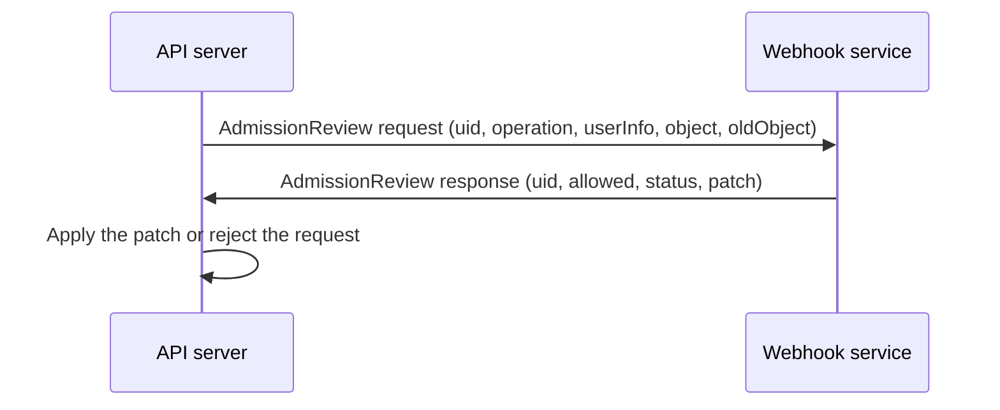

# Admission Webhooks, Failure And Exceptions

An admission webhook sends each matching request to a service that you run and acts on the answer. It can express any rule that code can express, such as "only images that carry a valid signature". It also adds a new component to the path of every matching request. This part shows what the API server sends, what the service must provide, what happens when the service does not answer, and how exceptions and image evidence weaken a rule.

## What a webhook is

A webhook is configured with a `ValidatingWebhookConfiguration` or a `MutatingWebhookConfiguration`. Each entry names a service or a URL and describes the requests to send. When a request matches, the API server posts an `AdmissionReview` JSON document over HTTPS, and the service answers with another one.



The request carries the operation, the identity of the caller (`userInfo`), the new object and, on an update, the old one. The response repeats the `uid` and sets `allowed` to true or false. A validating webhook can add a message in `status` and warnings in `warnings`. A mutating webhook can return a JSON Patch, base64 encoded, with `patchType: JSONPatch`. The patch is applied to the object before the next stage.

Mutating webhooks are called one after another, so that each one sees the result of the previous one. The API server can call a mutating webhook again when a later one changes the object, if the webhook asks for it with `reinvocationPolicy`. Validating webhooks are called in parallel, and the request is rejected if any one rejects it.

## What the service must provide

- **A reachable endpoint.** A `service` reference gives the namespace, name, port and path. The API server calls it from the control plane, so the service must be reachable from there.
- **A trusted certificate.** The API server connects over HTTPS and checks the certificate against `caBundle`, a CA certificate in the configuration. If `caBundle` is empty it uses its own trust roots. The certificate must be valid for the name `<service>.<namespace>.svc`.
- **A correct decision.** The code and the image of the service are part of the decision. A bug in it, or a replaced image, changes the rule for every request that it handles.
- **A bounded answer time.** `timeoutSeconds` is between 1 and 30 and defaults to 10.
- **Declared side effects.** `sideEffects` must be `None` or `NoneOnDryRun` for the API server to call the webhook during a dry run. A webhook that writes elsewhere must say so.

## What decides coverage

A webhook sees only what its entry matches:

- `rules` choose the API groups, versions, resources, scopes and operations.
- `namespaceSelector` and `objectSelector` limit the matches by labels on the namespace or on the object. An object whose labels do not match is skipped, so a rule that selects by label on the object can be avoided by an author who leaves the label out.
- `matchPolicy: Equivalent` makes a rule for one API version also match the same resource in another version. `Exact` does not.
- Calls to webhook configurations themselves are never sent to webhooks. A webhook cannot block the change of its own configuration, so that control belongs to RBAC.

## What happens when the service does not answer

`failurePolicy` decides it for each entry:

- `Fail` rejects the request. The rule keeps its meaning and an outage of the service blocks matching changes.
- `Ignore` admits the request. Deployments keep working and the rule is not applied for as long as the service is down or slow.

Neither is correct everywhere. A webhook that matches Pods in `kube-system` with `Fail` and runs as a Pod in the same cluster has a loop: if the service stops, new Pods cannot be created, including the replacement for the service. Webhook entries that match system namespaces are a common cause of a locked control plane. Exclude them with a `namespaceSelector`, or use `Ignore` for those objects, and say so in the design.

Register a webhook that points to a Service that does not exist. It is limited to a labelled `ConfigMap` in `outpost`, so nothing else is affected:

<!-- astrona:playground:renew -->

```sh
cat > demo-webhook.yaml <<'YAML'
apiVersion: admissionregistration.k8s.io/v1
kind: ValidatingWebhookConfiguration
metadata:
  name: demo-webhook
webhooks:
  - name: demo.starfleet.example
    admissionReviewVersions: ["v1"]
    sideEffects: None
    failurePolicy: Ignore
    timeoutSeconds: 5
    rules:
      - apiGroups: [""]
        apiVersions: ["v1"]
        operations: ["CREATE"]
        resources: ["configmaps"]
    namespaceSelector:
      matchLabels:
        kubernetes.io/metadata.name: outpost
    objectSelector:
      matchLabels:
        webhook-test: "true"
    clientConfig:
      service:
        namespace: outpost
        name: missing-webhook
        path: /validate
        port: 443
YAML
kubectl apply -f demo-webhook.yaml
```

Send a labelled `ConfigMap` and an unlabelled one:

```sh
cm() {
  kubectl apply -n outpost --dry-run=server -f - <<YAML
apiVersion: v1
kind: ConfigMap
metadata:
  name: demo
  labels:
    webhook-test: "$1"
YAML
}
cm "true"
cm "false"
```

With `failurePolicy: Ignore` both requests are admitted, and the first one can print a warning that the webhook call failed. The webhook never answered, and the rule did not apply. Change the policy to `Fail` and repeat:

```sh
kubectl patch validatingwebhookconfiguration demo-webhook --type=json -p '[{"op":"replace","path":"/webhooks/0/failurePolicy","value":"Fail"}]'
cm "true"
cm "false"
```

The first request is rejected with `failed calling webhook "demo.starfleet.example"` and a reason such as `service "missing-webhook" not found`. The second is admitted, because its label does not match the `objectSelector`. The same lines show both sides of the trade: `Fail` keeps the rule and blocks the change when the service is gone, and the unlabelled object shows that the selector, not the rule, decided what was covered. Remove the webhook:

```sh
kubectl delete validatingwebhookconfiguration demo-webhook
```

## Webhooks as part of the trust chain

A webhook that mutates can set any field of any object that it matches, including images, volumes and security contexts. A webhook that validates receives the full request, which can include Secrets and the identity of the caller. Both make the webhook workload as sensitive as the API server for the objects that it covers:

- Limit who can update the webhook configuration and who can change the Deployment, the image and the serving certificate of the service.
- Run the service with the least privilege, on its own service account, and without a path from other namespaces.
- Do not log full request bodies, because they can contain Secrets.
- Watch its health. The API server publishes metrics for the webhook calls, with counts of rejections and errors, and a rise in errors is the first sign of a gap.

## Exceptions weaken a rule

Policies need exceptions. System workloads need privileges, and a migration needs a grace period. Each exception is a place where the rule does not apply, so give it a reason, an owner and a limit:

- An exempted namespace is a namespace where any workload can run with any setting. Anyone who can create objects there can use it.
- An exemption chosen by a label can be gained by whoever can set the label. Protect the permission to change those labels.
- A time limit that nobody reviews is permanent.

## Image evidence and mutable tags

A rule that checks images shows why a rule needs a precise contract. A signature or a scan result is created for one artifact. A tag such as `1.4` or `latest` is a name that can be moved to different content. Evidence that was checked for a tag is not evidence for the content that the tag points to later. A rule that approves by tag can approve changed content after the tag is updated. A rule that resolves the tag to a digest, and checks the evidence for the digest, binds the approval to the exact image. A passing check still proves only that the configured rule passed, not that the application has no defect.

## Operating admission rules

- Before you move a rule from `Warn` to `Deny`, read the warnings and the audit events to find the workloads that would fail, and fix them.
- Keep the rejection message useful, because it is what the author of the object sees.
- Test every rule from both sides: an object that must be rejected and an object that must be admitted, with a server-side dry run, as a part of the pipeline.
- Review the full list: the rules, the bindings, the namespace labels, the exceptions and the failure policy. The control is the combination, not any single object.

## Common pitfalls

> [!WARNING]
> A registered webhook does not prove that every request is covered or blocked on failure: selectors can leave objects out, and `Ignore` admits requests when the service is down. A webhook that matches the namespace of its own service, or `kube-system`, can lock the creation of Pods. Exemptions and labels that grant them are bypasses. Approval by a mutable tag is not approval of the content.
