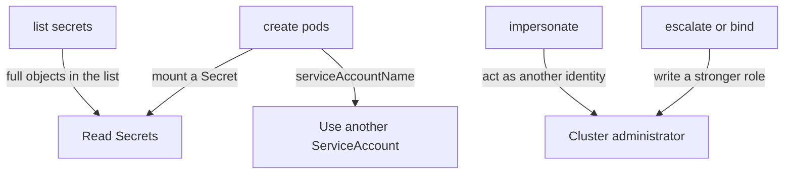

# Dangerous Permissions And Privilege Escalation

Some RBAC rules look small and are as strong as cluster-admin. This part lists the permissions that let a caller reach more than its grants appear to give, explains the mechanism behind each, and shows how to find them in a running cluster.

## Wildcards

A rule with `verbs: ["*"]`, `resources: ["*"]` or `apiGroups: ["*"]` matches everything in that position, including resources that do not exist yet. A wildcard on resources in an API group also covers custom resources that an operator installs later. A Role with all three wildcards in a namespace is effectively namespace administrator: it can read Secrets, create Pods and edit RoleBindings in that namespace. The built-in `cluster-admin` ClusterRole is exactly this rule.

## Reading Secrets

`get` on `secrets` returns the data of one named Secret. `list` and `watch` on `secrets` return the data of all of them, because a list response contains the full objects. Granting `list` is therefore as strong as granting `get` for every Secret in scope. A ServiceAccount token Secret or a database password in a namespace goes to anyone who can list there.

## Creating Pods

`create` on `pods` looks like a workload permission. It is also a read permission for every Secret in the namespace, for two reasons. The new Pod can mount any Secret as a volume or an environment variable, and then print it. The Pod can also run as any ServiceAccount in the namespace through `serviceAccountName`, and use that ServiceAccount's token and permissions. Creating a Pod also allows the Pod to request a privileged security context unless admission blocks it.

The same reasoning covers `create` on workload resources that make Pods: Deployments, DaemonSets, StatefulSets, Jobs and CronJobs.

`create` on `pods/exec` and `pods/attach` runs a command inside an existing container. The caller then holds whatever that container holds, including its mounted ServiceAccount token.

## Escalate, bind and impersonate

Kubernetes stops a user from creating or updating a Role that grants permissions the user does not already hold. This is escalation prevention. Three verbs remove the protection:

- `escalate` on `roles` or `clusterroles` lets a user write rules the user does not hold.
- `bind` on `roles` or `clusterroles` lets a user create a binding to a role that holds more than the user does.
- `impersonate` on `users`, `groups` or `serviceaccounts` lets the caller act as that identity. Impersonating `system:masters` is a cluster administrator.

Related paths exist. `create` on `serviceaccounts/token` allows requesting a token for any ServiceAccount in the namespace. `update` on `nodes` or `nodes/proxy` can expose the kubelet API and every container on a node.



## Bindings to broad groups

A binding to `system:unauthenticated` gives the role to anyone who can reach the API server, including requests with no credential at all. A binding to `system:authenticated` gives it to every identity that passed authentication, including every ServiceAccount in every namespace. Neither belongs in a production cluster except for the narrow discovery roles that Kubernetes installs. A binding to a group name, for example `crew`, is only as strong as the process that decides who may hold a certificate with that Organization field.

## Find them in the playground

Renew the playground and list the identities bound to `cluster-admin`:

<!-- astrona:playground:renew -->

```sh
kubectl get clusterrolebindings -o json | jq -r '.items[] | select(.roleRef.name == "cluster-admin") | .metadata.name + " -> " + ([.subjects[]? | .kind + ":" + .name] | join(","))'
```

Every subject on that list is a full administrator. Check bindings to the broad groups:

```sh
kubectl get clusterrolebindings,rolebindings -A -o json | jq -r '.items[] | select(any(.subjects[]?; .name == "system:unauthenticated" or .name == "system:authenticated")) | .kind + " " + .metadata.name'
```

The default list contains only the discovery and basic-user roles that Kubernetes installs. Now create a Role with a dangerous rule and test it. Save this as `role-risky.yaml`:

```yaml
apiVersion: rbac.authorization.k8s.io/v1
kind: Role
metadata:
  name: risky
  namespace: starfleet
rules:
  - apiGroups: [""]
    resources: ["pods"]
    verbs: ["create"]
---
apiVersion: rbac.authorization.k8s.io/v1
kind: RoleBinding
metadata:
  name: risky-mira
  namespace: starfleet
subjects:
  - kind: User
    name: mira
    apiGroup: rbac.authorization.k8s.io
roleRef:
  kind: Role
  name: risky
  apiGroup: rbac.authorization.k8s.io
```

Apply it and test:

```sh
kubectl apply -f role-risky.yaml
kubectl auth can-i create pods -n starfleet --as=mira
kubectl auth can-i get secrets -n starfleet --as=mira
```

The second answer is `no`. Mira cannot read a Secret directly. She can still start a Pod that mounts one, and read it from the Pod log. Authorization cannot see that, because the Secret mount is inside the body of the request. Pod Security Admission does not stop it either, because mounting a Secret is allowed at every level.

## Audit and reduce

Review roles for the dangerous patterns with a filter. This command lists every Role and ClusterRole with a wildcard or an escalation verb:

```sh
kubectl get roles,clusterroles -A -o json | jq -r '.items[] | select(any(.rules[]?; any(.verbs[]?; . == "*" or . == "escalate" or . == "bind" or . == "impersonate"))) | .kind + " " + (.metadata.namespace // "-") + "/" + .metadata.name'
```

System roles will appear. Review the ones you or your tools created. To reduce a grant, list the exact verbs and resources the identity uses and write a Role for those. Prefer a RoleBinding to a built-in ClusterRole like `view` over a new Role. Give a workload its own ServiceAccount and bind only that.

## Common pitfalls

> [!WARNING]
> - Treating `create pods` as harmless. It reads every Secret in the namespace through a volume mount.
> - Granting `list secrets` to monitoring or backup tools without scoping them to resource names or a namespace.
> - Giving a controller `escalate`, `bind` or `impersonate` for convenience. Each one is a path to cluster administrator.
> - Binding a role to `system:authenticated` to give "every user" access. Every ServiceAccount counts as a user.
> - Reviewing only ClusterRoleBindings. RoleBindings in `kube-system` and other namespaces can bind ClusterRoles too.
