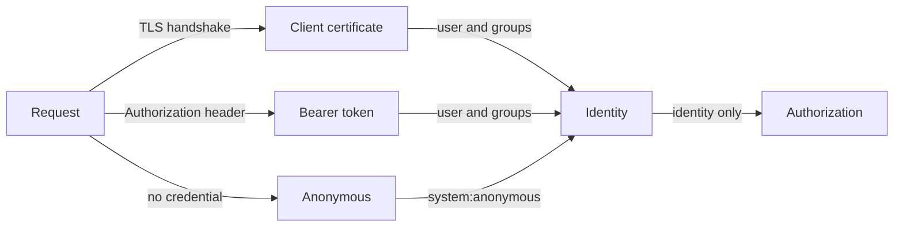

# How The API Server Authenticates Requests

Every request to the Kubernetes API server, from `kubectl`, from a controller or from a Pod, passes through the same sequence: authentication, authorization and admission. This part covers the first step. Authentication turns the credentials in a request into a user name, a user ID and a set of groups. Nothing else leaves this step.

## The authenticator chain

The API server holds a list of authenticators. Each one looks at the request and either recognises a credential it understands or passes. The API server tries the authenticators and uses the first one that accepts the request. If none accepts it and anonymous access is off, the API server answers `401 Unauthorized`.

The common authenticators are:

- Client certificates. The TLS handshake presents a certificate signed by the cluster certificate authority (CA) that the API server trusts through `--client-ca-file`. The user name is the certificate's Common Name (CN) and each Organization (O) field is a group.
- Bearer tokens in the `Authorization` header. ServiceAccount tokens are signed JSON Web Tokens (JWTs). The API server verifies the signature with the ServiceAccount signing key and then checks that the token is still valid for its bound object.
- OpenID Connect (OIDC) tokens. The API server verifies the token against an identity provider that an administrator configured.
- Bootstrap tokens, used when nodes join a cluster.
- Anonymous requests, when `--anonymous-auth` is enabled.

Kubernetes has no user object. There is no `kubectl create user`. A user exists only as the name and groups that an authenticator reads from a credential. Any holder of a certificate signed by the cluster CA with `CN=mira` is the user `mira`, whether or not anyone created her.



## What a user name looks like

An authenticated request carries three attributes: a user name, a UID and groups. The API server also adds the group `system:authenticated` to every identity that passed authentication, and `system:unauthenticated` to anonymous requests. Role bindings often name these two groups, so a binding to `system:unauthenticated` gives its permissions to anyone who can reach the API server.

ServiceAccount identities have a fixed form: the user name is `system:serviceaccount:<namespace>:<name>`, and the groups are `system:serviceaccounts` and `system:serviceaccounts:<namespace>`.

## Inspect your own identity

The command `kubectl auth whoami` asks the API server which identity it derived from your credentials. Renew the playground so you start from a clean state, then run it:

<!-- astrona:playground:renew -->

```sh
kubectl auth whoami
```

The output lists the user name and the groups. In a `kind` cluster the administrator certificate has the Common Name `kubernetes-admin` and the Organization `kubeadm:cluster-admins`. You can read both fields from the certificate in your kubeconfig:

```sh
kubectl config view --raw -o jsonpath='{.users[0].user.client-certificate-data}' | base64 -d | openssl x509 -noout -subject
```

The subject line contains the same name and group. The API server never asked anyone to register them.

## Anonymous requests

When `--anonymous-auth` is true, a request with no credential is not rejected at authentication. The API server labels it with the user `system:anonymous` and the group `system:unauthenticated`, and authorization decides the rest. In a default cluster, RBAC allows only a few anonymous reads, such as the health and version endpoints. Verify that the cluster refuses an anonymous caller to read Pods by impersonating the anonymous identity:

```sh
kubectl --as=system:anonymous get pods -n starfleet
```

The response is `Forbidden`. Impersonation changes the identity that authorization evaluates. It does not test authentication, so the administrator must hold the `impersonate` permission.

## 401 and 403 mean different things

The status code tells you which stage failed.

- `401 Unauthorized` means authentication failed. The API server could not turn the credentials into an identity. The cause is an expired certificate, an unknown CA, a token with a bad signature or no credential with anonymous access off.
- `403 Forbidden` means authentication succeeded and authorization refused. The error message names the identity: `User "system:anonymous" cannot list resource "pods"`. Replacing the credential will not help. The identity needs a role binding.

Reading the identity in a 403 message is the fastest way to find out whether a workload is using the ServiceAccount you think it is using.

## Credentials that cannot be revoked

The API server does not keep a list of issued client certificates. It cannot revoke one. A stolen certificate stays valid until its `notAfter` date. The practical defences are short certificate lifetimes and removing the permissions the identity holds. ServiceAccount tokens are different because they are bound to a Pod or have an expiry, and the next part explains how.

A bearer token is a password in transit. Anyone who can read a token can act as its identity from anywhere that can reach the API server. Tokens appear in places people forget: environment variables, process listings, log output and backups of Secrets.

## Where the chain is configured

The authenticators are switched on by flags on the `kube-apiserver` process. `--client-ca-file` enables certificate authentication, `--service-account-key-file` and `--service-account-signing-key-file` enable ServiceAccount tokens, `--oidc-issuer-url` enables OIDC and `--anonymous-auth` controls anonymous requests. On a kubeadm or `kind` cluster these flags sit in the static Pod manifest of the API server on the control plane node. Read them with this command:

```sh
kubectl -n kube-system get pod -l component=kube-apiserver -o jsonpath='{.items[0].spec.containers[0].command}' | tr ',' '\n' | grep -E 'client-ca|service-account|anonymous'
```

A managed cluster hides these flags, but the same mechanism applies. When a request fails with 401, the first questions are which authenticator should have accepted the credential and why it did not.

## Common pitfalls

> [!WARNING]
> - Treating `kubectl auth can-i` as an authentication test. It checks authorization for the identity you already have.
> - Assuming a user must be created before it can authenticate. A valid certificate with the right Common Name is enough.
> - Binding a role to `system:unauthenticated` or `system:authenticated`. Both groups are much larger than they look.
> - Fixing a 403 by replacing the token. A 403 means the identity is known and lacks permission.
> - Leaving `--anonymous-auth` on without reviewing which anonymous requests RBAC allows.
