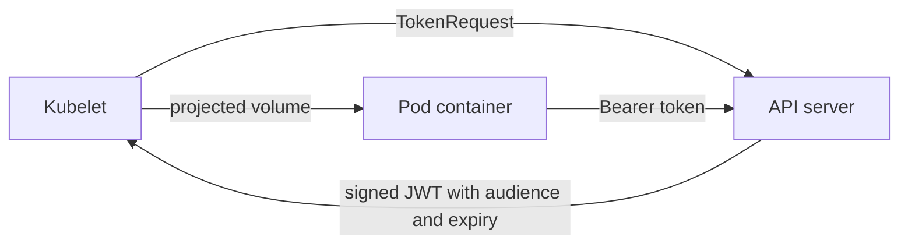

# ServiceAccount Tokens And Client Certificates

Pods and people authenticate differently. A Pod proves its identity with a ServiceAccount token that the kubelet delivers to the container. A person usually holds a client certificate or an OIDC token. This part shows how each credential is issued, how long it lives and how to limit what a workload receives.

## ServiceAccounts and bound tokens

A ServiceAccount is a namespaced object that gives a workload an identity. Every namespace has a ServiceAccount named `default`. Creating a Pod without `serviceAccountName` uses it.

Since Kubernetes 1.22 a Pod receives a bound token, not a long-lived secret. The kubelet asks the API server for a token through the TokenRequest API and mounts it as a projected volume. A bound token has four properties:

- It is bound to the Pod. When the Pod is deleted, the API server stops accepting the token.
- It has an audience. By default the audience is the API server. A service that checks the audience rejects tokens meant for another service.
- It expires. The default lifetime is one hour, and the kubelet refreshes the file before it expires.
- It is a signed JWT, so the API server checks it without a database lookup of a Secret.

The kubelet projects the token into every container at `/var/run/secrets/kubernetes.io/serviceaccount/token`, next to `ca.crt` and `namespace`. A process that can read the file can call the API server as that ServiceAccount.

## Request a token yourself

The command `kubectl create token` calls the TokenRequest API and prints a short-lived token. Renew the playground and request one for the `default` ServiceAccount in `starfleet`:

<!-- astrona:playground:renew -->

```sh
kubectl -n starfleet create token default --duration=10m
```

Decode the payload to see the claims. The command below cuts out the middle part of the JWT and decodes it:

```sh
kubectl -n starfleet create token default --duration=10m | cut -d. -f2 | base64 -d 2>/dev/null | jq '{sub, aud, exp, iat}'
```

The `sub` claim reads `system:serviceaccount:starfleet:default`. The `aud` claim names the API server, and `exp` is ten minutes after `iat`. The lifetime must be at least ten minutes.

## Who gets a token

By default Kubernetes mounts a token into every Pod, whether or not the application calls the API. The field `automountServiceAccountToken` turns this off. It can be set on the ServiceAccount, which affects all of its Pods, or on the Pod, which wins over the ServiceAccount value. Save this as `serviceaccount-probe.yaml`:

```yaml
apiVersion: v1
kind: ServiceAccount
metadata:
  name: probe-sa
  namespace: starfleet
automountServiceAccountToken: false
```

Apply it and start a Pod that uses it:

```sh
kubectl apply -f serviceaccount-probe.yaml
kubectl -n starfleet run probe-check --image=curlimages/curl:8.22.0 --overrides='{"spec":{"serviceAccountName":"probe-sa"}}' --command -- sleep 3600
```

Check that the Pod has no token volume:

```sh
kubectl -n starfleet get pod probe-check -o jsonpath='{.spec.volumes}'
```

The output is empty. Without the setting the Pod lists a projected volume named `kube-api-access-...`. Changing the ServiceAccount does not change running Pods. Their volumes are fixed at creation, so a rollout is needed.



## Legacy token Secrets

Before Kubernetes 1.24 the control plane created a Secret of type `kubernetes.io/service-account-token` for each ServiceAccount. That token never expired and was not bound to a Pod. New clusters no longer create these Secrets automatically. An administrator can still create one by hand with the annotation `kubernetes.io/service-account.name`, and the token controller fills it. Such a Secret is a permanent credential that appears in backups, in `kubectl get secret -o yaml` output and in every copy of the namespace. List them to find any that remain:

```sh
kubectl get secrets -A --field-selector type=kubernetes.io/service-account-token
```

Delete the ones you do not need. Applications that need a token outside a Pod should use `kubectl create token` or the TokenRequest API with a short lifetime.

## Client certificates through a CertificateSigningRequest

A person needs a credential that the API server trusts. The CertificateSigningRequest (CSR) API lets the cluster CA sign a certificate request without giving anyone the CA key. The steps are:

1. The user generates a private key and a certificate request. The request subject carries the user name and groups.
2. An administrator creates a `CertificateSigningRequest` object with the request, a signer and the usages.
3. An administrator approves it. The signer then writes the certificate to `status.certificate`.
4. The user builds a kubeconfig from the key and the certificate.

Generate the key and the request in the shell:

```sh
openssl genrsa -out mira.key 2048
openssl req -new -key mira.key -subj "/CN=mira/O=crew" -out mira.csr
```

Save this as `csr-mira.yaml`. The field `request` takes the base64 encoding of the request without line breaks. Replace the placeholder with the output of `base64 < mira.csr | tr -d '\n'`:

```yaml
apiVersion: certificates.k8s.io/v1
kind: CertificateSigningRequest
metadata:
  name: mira
spec:
  request: REPLACE_WITH_BASE64_REQUEST
  signerName: kubernetes.io/kube-apiserver-client
  expirationSeconds: 86400
  usages:
    - client auth
```

Apply it, approve it and read the certificate subject:

```sh
kubectl apply -f csr-mira.yaml
kubectl certificate approve mira
kubectl get csr mira -o jsonpath='{.status.certificate}' | base64 -d | openssl x509 -noout -subject -enddate
```

The subject reads `CN=mira, O=crew` and the expiry is one day away. The signer `kubernetes.io/kube-apiserver-client` is the one the API server accepts for client authentication, and it refuses requests whose usages include anything else. Short `expirationSeconds` values are the only form of revocation, because the API server cannot revoke a certificate.

## Authentication is not permission

The new user `mira` authenticates, but a request still returns 403 until a role binding exists. Verify it with `kubectl --as=mira auth can-i list pods -n starfleet`. The answer is `no`. The certificate proves who she is, and RBAC decides what she may do.

## Common pitfalls

> [!WARNING]
> - Leaving automounting on for Pods that never call the API. Each mounted token is a credential an attacker can read.
> - Changing `automountServiceAccountToken` on a ServiceAccount and expecting running Pods to change. Only new Pods are affected.
> - Creating `kubernetes.io/service-account-token` Secrets for convenience. They never expire.
> - Giving a CSR a long `expirationSeconds`, since the API server cannot revoke the certificate.
> - Approving a CSR without reading its subject. The approver decides the user name and groups that the signer writes.
