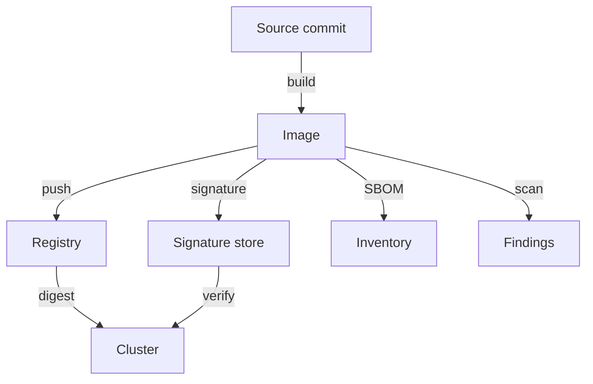

# Artifact Evidence And Sensitive Build Inputs

A supply chain attack does not need to break into the cluster. It only needs to change something that the cluster trusts: a dependency, a build script, a tag in a registry. This part names the pieces of evidence that exist about a container image and shows what each one can and cannot prove. It matters because a team that treats one passed check as a full guarantee will deploy the wrong image with a clear conscience.

## One image, five questions

Take the image `ghcr.io/stefanprodan/podinfo:6.15.0` that the `scout` Deployment runs. Five different questions can be asked about it, and five different kinds of evidence answer them.

The first question is which bytes run. A **digest** answers it. A digest is the SHA-256 hash of the image manifest, written `sha256:` followed by 64 hexadecimal characters. If one byte of the image changes, the digest changes. A tag such as `6.15.0` is only a name in the registry, and the registry owner can move it to another digest at any time.

The second question is who vouches for the bytes. A **signature** answers it. A tool such as `cosign` signs the digest with a private key, or with a short-lived certificate tied to an identity such as a CI workflow. Anyone with the matching public key or trusted identity can verify the signature. The signature proves that the signer approved this digest. It does not prove that the code is free of defects.

The third question is how the image was built. **Provenance** answers it. Provenance is a signed statement that records the source repository, the commit, the builder and the build steps. Frameworks such as SLSA (Supply-chain Levels for Software Artifacts) define how trustworthy that statement is, depending on whether the build system or the developer could have forged it.

The fourth question is what the image contains. A **software bill of materials** (SBOM) answers it. An SBOM is a list of the packages and libraries inside the image, in a format such as SPDX or CycloneDX. It does not say whether any of them is dangerous.

The fifth question is whether a known flaw is present. A **vulnerability scan** answers it. A scanner such as Trivy or Grype compares the packages it finds with a database of published vulnerabilities. The result changes every day, because the database changes, not the image.



The diagram shows that every piece of evidence is attached to the image digest, and the cluster is the last place where the evidence can be checked.

## What each piece of evidence cannot prove

Each kind of evidence has a limit, and attackers use that limit. A valid signature on a vulnerable image only proves that someone signed a vulnerable image. A clean scan on an image from an unknown publisher only proves that no known flaw was found. An SBOM that was created from the source tree, not from the built image, can describe the wrong content. A provenance statement that the build system itself can edit gives no protection against a compromised build system.

A second limit is time. A scan result is correct on the day it runs. An image that was clean in March can contain a critical vulnerability in June without a single byte changing. A supply chain process therefore scans again on a schedule and rebuilds from patched base images.

A third limit is linkage. Evidence is only useful when it names the same digest that the cluster runs. If the pipeline scans `podinfo:6.15.0` at 10:00 and the cluster pulls `podinfo:6.15.0` at 11:00 after the tag moved, the scan result describes a different image than the one that runs.

## Sensitive build inputs

An image is built from inputs, and some inputs are secret: a registry password, a package repository token, a private key for code signing. Every layer of an image is stored in the registry and can be pulled by anyone who can pull the image. A secret that is copied into a layer, even in a step that a later step deletes, stays readable in that layer.

Build tools offer safer inputs. A build secret mount (for example `RUN --mount=type=secret` in a Dockerfile built with BuildKit) gives a build step temporary access to a secret without writing it to a layer. Multi-stage builds copy only the final binary into the runtime image, so the compiler, the source and the build credentials never reach the image that is published.

Build systems also need least privilege. A pipeline that can push to every repository can overwrite any image. A pipeline that has one short-lived credential for one repository limits what a stolen credential can change. The same idea applies to the people who can edit the pipeline definition, because whoever edits the pipeline controls what it signs.

## What you can check from the cluster

A cluster cannot see the source or the build, but it can see the image reference in each pod and the digest of the image that the container runtime pulled. To read the digest of the running `scout` container, run:

<!-- astrona:playground:renew -->

```sh
kubectl -n starfleet get pod -l app=scout -o jsonpath='{.items[0].status.containerStatuses[0].imageID}'
```

The command prints the image name followed by `@sha256:` and the digest the container runtime resolved. The field `imageID` in the pod status is the identity of the content that runs, while the field `image` in the pod spec only holds the name that was requested.

To see the requested name, run:

```sh
kubectl -n starfleet get deploy scout -o jsonpath='{.spec.template.spec.containers[0].image}'
```

The two values are different kinds of information. The first is what ran. The second is what was asked for. A Deployment that asks for a tag and a pod that reports a digest show that a tag was resolved at pull time, and the next pull can resolve it to something else.

You can now verify which digest runs. The open question is how to make the cluster run only the digest you approved.

## Trust boundaries along the chain

A trust boundary is a point where one party hands an artifact to another party that cannot see how it was made. There are four in this chain. The first is between source and build: the build system trusts that the commit it checks out is the reviewed one. The second is between build and publication: the registry trusts that the pipeline credential belongs to the real pipeline. The third is between publication and deployment: the cluster trusts that the name in the pod specification still points to what was published. The fourth is between deployment and runtime: the container receives credentials and a network position, and trusts nothing it should not.

At each boundary a different control applies. Reviewed commits and protected branches guard the first. Scoped, short-lived publication credentials and signed provenance guard the second. Digest references and signature verification guard the third. Least privilege, restricted pod settings and minimal credentials guard the fourth. A weak control at one boundary cannot be repaired at another, because the later party cannot see what happened earlier.

Consider a worked failure. A developer account that can merge to the main branch is phished. The attacker merges a change that sends the registry password to an outside address. The build is real, the signature is real, the digest matches and the scan finds no known vulnerability. Every check at the later boundaries passes, because the only broken control was the first one. The lesson is that evidence downstream proves consistency with what was built, not that what was built was wanted.

## Dependencies are inputs too

Most of the bytes in an image come from other people: the base image, operating system packages and language libraries. A dependency can be replaced by a malicious package with a similar name, or a maintainer account can be taken over. Pinning dependency versions, verifying their hashes through a lock file, and pulling them from a controlled internal mirror reduce the risk. A base image should come from a publisher you trust and should be rebuilt on a schedule so security fixes reach your image.

## Common pitfalls

> [!WARNING]
> - Treating a signature as a statement that an image is safe. It only states who approved a digest.
> - Trusting a scan result without checking which digest was scanned and when.
> - Deleting a secret in a later Dockerfile step. The earlier layer still holds it.
> - Using one broad registry credential for every pipeline.
