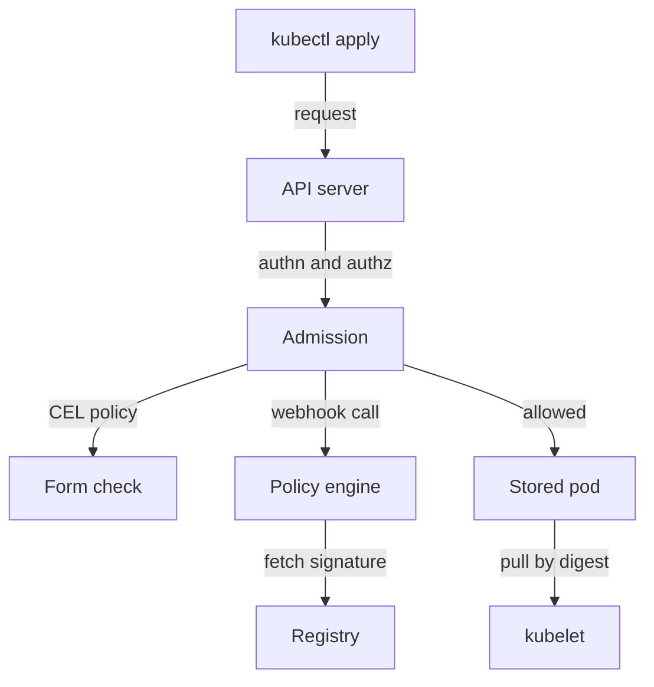

# Connecting Verification To Execution Policy

Evidence helps only if the cluster uses it. A signature that nobody checks at deployment time protects nothing, and a digest that is written in a ticket but not in the Deployment does not stop a tag from moving. This part pins a workload to an exact digest and then looks at the places where a cluster can refuse an image that fails verification.

## Pin a workload to a digest

The `scout` Deployment starts with the image `ghcr.io/stefanprodan/podinfo:6.15.0`. A reference with a tag lets the container runtime ask the registry which digest the tag points to every time it pulls the image. A reference with a digest has the form `repository@sha256:<64 hex characters>`. The runtime asks for exactly that content and refuses anything whose hash differs.

First read the digest of what runs now and store it in a shell variable, so the next command does not need a copied value:

<!-- astrona:playground:renew -->

```sh
SCOUT_DIGEST=$(kubectl -n starfleet get pod -l app=scout -o jsonpath='{.items[0].status.containerStatuses[0].imageID}' | sed 's/.*@//')
echo "$SCOUT_DIGEST"
```

The `sed` command removes everything up to the `@`, so the variable holds only `sha256:` and the hash. Now change the Deployment to the digest reference:

```sh
kubectl -n starfleet set image deployment/scout scout=ghcr.io/stefanprodan/podinfo@${SCOUT_DIGEST}
kubectl -n starfleet rollout status deployment/scout
```

The Deployment controller creates a new ReplicaSet with the new pod template, and the kubelet on the node pulls the content with that digest. The container name `scout` on the left of the equals sign selects which container changes. Check the result:

```sh
kubectl -n starfleet get deploy scout -o jsonpath='{.spec.template.spec.containers[0].image}'
```

The image field now contains `@sha256:` and no tag. Notice what changed in meaning: before, the field said which release was wanted. Now it says which bytes are wanted. If the registry owner moves the tag `6.15.0` to a different image tomorrow, this Deployment is not affected.

## What a digest costs

A digest reference has a cost. The reference is not readable, so humans cannot see the release number. A tool such as Renovate or Dependabot can update digests automatically and open a reviewable change that shows the old and the new version. Some teams write both: `podinfo:6.15.0@sha256:...`. Kubernetes uses the digest and ignores the tag when both are present, and the tag is only a comment for readers.

A digest also names one image manifest. When a registry serves a multi-architecture image, the digest of the index selects the right platform at pull time. The digest of one platform image selects only that platform. Pin the one that matches how you build and test.

## Where a cluster can enforce verification

Pinning is a convention that people can forget. Enforcement is a check that runs on every pod creation. Kubernetes has several places for it, and each one sees different information.

The first place is **admission control**. The API server calls admission controllers after authentication and authorization and before it stores an object. A validating admission policy written in the Common Expression Language (CEL) can read the pod specification and reject a pod whose image field does not contain `@sha256:`, or whose registry is not on an approved list. This check sees only the specification, not the registry, so it can enforce the form of the reference but not verify a signature.

The second place is an **admission webhook**, which is an HTTPS service that the API server calls. A policy engine such as Kyverno (with its `verifyImages` rule), the Sigstore policy-controller, or Ratify runs as a webhook. It can contact the registry, find the signature for the digest, verify it against a public key or an identity, and reject the pod if verification fails. Some of these engines also rewrite a tag into its digest, so the stored pod specification is pinned.

The third place is the **kubelet and the container runtime**. They can be configured with a signature policy for image pulls, so every pull on a node is checked, even for pods that bypass the API server such as static pods. This is less common in Kubernetes distributions and is configured per node.



The diagram shows that the form check and the signature check both run before the object is stored, and the pull by digest runs afterward on the node.

## Failure cases to reason about

A webhook that verifies signatures is also a dependency. If its `failurePolicy` is `Ignore` and the webhook is down, unsigned images pass. If it is `Fail` and the webhook is down, no pod can be created. Neither setting is free, so the webhook needs replicas, a timeout and exemptions for the namespaces that run the cluster itself.

A signature check also depends on the trust anchor. If the policy trusts any signature from a public transparency log without naming the expected identity, an attacker can sign their own image and pass. A strong policy names who must have signed: a specific public key or a specific CI workflow identity.

Last, image verification checks creation. A pod that already runs is not re-checked when the policy changes. Teams combine admission checks with periodic audits of running workloads.

Try one more check yourself. List every image that runs in the cluster and see which ones use a digest:

```sh
kubectl get pods -A -o jsonpath='{range .items[*]}{.metadata.namespace}{"\t"}{.spec.containers[*].image}{"\n"}{end}'
```

Only `scout` should show `@sha256:` in the playground, and that is the list a policy would report. You now know how to pin an image and where enforcement can live. What is left is the other half of the supply chain: the credentials the running container holds.

## A short worked decision

Suppose the platform team must stop any unsigned image from running in `starfleet`. Which control fits? A CEL policy cannot reach the registry, so it cannot check a signature. It can still require that the reference ends in a digest, which makes later verification meaningful. A webhook-based policy engine can verify the signature, so it is the control that answers the question. The kubelet signature policy is the third option, and it also protects pods that never pass through the API server.

The strongest design uses two layers. The CEL policy requires a digest form and an approved registry, and is simple, fast and available even when the webhook is down. The webhook policy verifies the signer and is the part that can fail open or closed. Each layer covers a failure of the other.

## Common pitfalls

> [!WARNING]
> - Pinning in the Deployment while the build pipeline still deploys by tag. The next rollout from the pipeline undoes the pin.
> - Reading the digest from a tag in the registry web page at a different time than the one that runs.
> - A signature policy that accepts any valid signature instead of naming the expected signer.
> - A webhook with `failurePolicy: Ignore` that silently stops enforcing when it is down.
